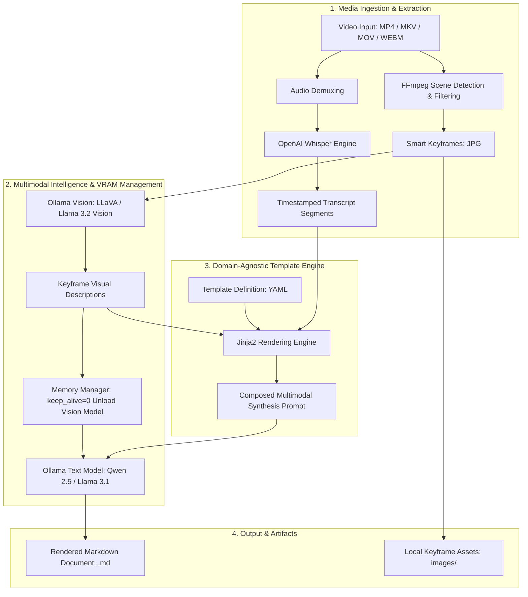
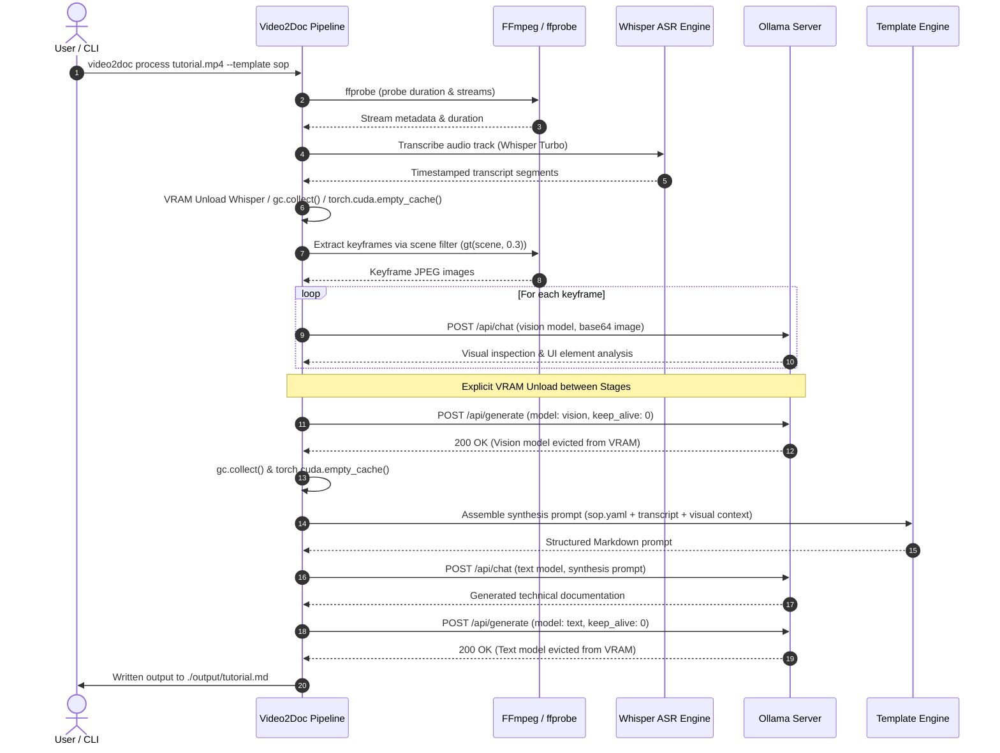

# Video2Doc: Multimodal Video Documentation Framework

[](https://www.python.org/)
[](https://opensource.org/licenses/MIT)
[](https://typer.tiangolo.com/)
[](https://ollama.com/)
[](https://github.com/openai/whisper)
[](https://ffmpeg.org/)
[](https://pytest.org/)
[](https://github.com/)

**Video2Doc** is an open-source, production-ready multimodal documentation engine that converts raw screencasts, technical presentations, and instructional videos into publication-grade Markdown documentation (SOPs, Academic Notes, Executive Briefings). Powered by local Vision-Language Models (VLMs) and Speech-to-Text (ASR) via Ollama and OpenAI Whisper, Video2Doc runs **100% locally with zero cloud API dependencies and zero data leakage**.

---

## Architecture

Video2Doc uses a decoupled multi-stage pipeline designed for memory efficiency on consumer GPUs (8GB–16GB VRAM) through explicit stage cleanup and model unloading.

### 1. System Architecture Diagram



### 2. Multi-Stage VRAM Memory Management Sequence



---

## Feature Highlights

Video2Doc implements 17 core features across media extraction, local multimodal intelligence, templating, and CLI operations:

| # | Feature | Description |
|---|---|---|
| **F1** | **Whisper Audio ASR** | Robust speech-to-text pipeline supporting `faster-whisper` and `openai-whisper` with automatic language detection and timestamped segment extraction. |
| **F2** | **Smart Keyframes** | Adaptive scene change detection via FFmpeg (`gt(scene, 0.3)`) debounced with temporal spacing and fallback to equidistant interval sampling. |
| **F3** | **Vision Analysis** | Multimodal frame analysis using local vision models (e.g., `llama3.2-vision`, `llava`) via Ollama with base64 image encoding. |
| **F4** | **Text Synthesis** | Context-aware document generation synthesizing spoken narration with visual cues via local reasoning LLMs (e.g., `qwen2.5-coder:14b`). |
| **F5** | **Memory & VRAM Management** | Strict stage cleanup evicting models (`keep_alive: 0`), invoking Python garbage collection, and clearing PyTorch CUDA caches between pipeline steps. |
| **F6** | **Domain-Agnostic Template Engine** | Jinja2 templating with custom filters for timestamps (`format_timestamp`), durations (`format_duration`), and code fences (`code_block`). |
| **F7** | **Built-in SOP Template** | Technical procedure manual layout detailing prerequisites, step-by-step UI actions, parameter matrices, and troubleshooting. |
| **F8** | **Built-in Lecture Template** | Academic research notes layout emphasizing theoretical derivations, LaTeX formulas, slide transcripts, and study questions. |
| **F9** | **Built-in Executive Template** | Executive briefing format distilling strategic outcomes, key decisions, milestone dates, and prioritized action item matrices. |
| **F10** | **Custom Template Support** | Extensible YAML/Jinja2 template loader validating custom user templates loaded via file paths or `~/.video2doc/templates/`. |
| **F11** | **Modern Typed CLI** | Ergonomic CLI built with Typer and Rich offering `process`, `batch`, `templates`, and `config` commands with rich terminal styling. |
| **F12** | **Multi-Tier Configuration** | Pydantic Settings supporting hierarchical resolution: CLI arguments > Environment variables (`VIDEO2DOC_*`) > `.env` file > Defaults. |
| **F13** | **Pre-flight Diagnostics** | Built-in environment verification inspecting FFmpeg/ffprobe PATH availability, Ollama connectivity, and model availability. |
| **F14** | **Strict Git Hygiene** | Production `.gitignore` preventing accidental commits of virtual environments, raw media binaries, logs, or proprietary transcripts. |
| **F15** | **Portfolio Documentation** | Comprehensive documentation featuring Mermaid architecture diagrams, quickstart instructions, and complete usage guides. |
| **F16** | **Packaging & Dependencies** | PEP 621 compliant `pyproject.toml` with console script entry point `video2doc` and pinned `requirements.txt`. |
| **F17** | **Automated E2E Test Suite** | Multi-tier test suite covering CLI parsing, template engine rendering, pipeline execution, edge cases, and real-world workloads. |

---

## Quickstart & Installation

### 1. Prerequisites

- **Python**: Version 3.10, 3.11, or 3.12.
- **FFmpeg & ffprobe**: Required for media demuxing and keyframe extraction.
  - Windows: `winget install Gyan.FFmpeg` or `choco install ffmpeg`
  - macOS: `brew install ffmpeg`
  - Ubuntu/Debian: `sudo apt update && sudo apt install ffmpeg`
- **Ollama**: Local LLM server running on `http://localhost:11434`.
  - Install from [ollama.com](https://ollama.com)
  - Start the daemon: `ollama serve`

### 2. Pull Local AI Models

Pull the default vision and text models used by Video2Doc:

```bash
# Vision model (for keyframe screenshot analysis)
ollama pull llama3.2-vision

# Text model (for document synthesis and summarization)
ollama pull qwen2.5-coder:14b
```

### 3. Install Video2Doc

Clone the repository and install the package:

```bash
git clone https://github.com/example/video2doc.git
cd video2doc

# Create and activate virtual environment
python -m venv venv
# Windows:
venv\Scripts\activate
# Linux / macOS:
source venv/bin/activate

# Install dependencies and editable package
pip install -e .
```

### 4. Verify Installation

Run the pre-flight diagnostic check:

```bash
video2doc config check
```

---

## CLI Usage Examples

### 1. Process a Single Video (`video2doc process`)

Convert a video into a technical Standard Operating Procedure (SOP):

```bash
video2doc process ./tutorials/docker_setup.mp4 --template sop --output-dir ./docs
```

#### Custom Model & Keyframe Overrides

```bash
video2doc process ./lectures/neural_nets.mp4 \
  --template lecture \
  --model-vision llama3.2-vision \
  --model-text qwen2.5-coder:14b \
  --whisper-model turbo \
  --scene-threshold 0.4 \
  --max-frames 12 \
  --output-dir ./academic_notes
```

#### Using a Custom Template

```bash
video2doc process ./demo.mp4 --template ./my_templates/custom_brand.yaml --output-dir ./output
```

### 2. Batch Processing a Directory (`video2doc batch`)

Process an entire folder of educational videos into structured notes:

```bash
video2doc batch ./course_videos --template lecture --output-dir ./curriculum_docs
```

### 3. Template Management (`video2doc templates`)

#### List Available Templates

```bash
video2doc templates list
```

#### Inspect Template Prompts and Sections

```bash
video2doc templates show sop
```

#### Scaffold a New Custom Template

```bash
video2doc templates init ./my_custom_template.yaml
```

### 4. Configuration & Diagnostics (`video2doc config`)

#### View Resolved Active Settings

```bash
video2doc config show
```

#### Run Pre-Flight Diagnostics

```bash
video2doc config check
```

---

## Built-in Templates Overview

Video2Doc includes three production-tested templates out of the box:

### 1. Standard Operating Procedure (`sop`)
- **Use Case**: Software tutorials, DevOps runbooks, GUI workflows, SaaS onboarding.
- **Vision Focus**: Active window titles, clicked UI elements, dialog parameters, and status banners.
- **Sections**:
  1. Executive Summary & Objective
  2. Prerequisites & Environment
  3. Step-by-Step Procedure (with timestamped actions)
  4. Configuration & Parameter Matrix
  5. Troubleshooting & Common Pitfalls
  6. Verification & Acceptance Criteria

### 2. Academic Lecture & Research Notes (`lecture`)
- **Use Case**: University seminars, technical conference talks, research symposiums.
- **Vision Focus**: Presentation slides, mathematical equations, whiteboard derivations, diagrams.
- **Sections**:
  1. Abstract & Topic Overview
  2. Core Concepts & Mathematical Notation
  3. Theoretical Framework & Derivations (LaTeX `$$...$$`)
  4. Methodological Architecture
  5. Empirical Results & Findings
  6. Open Questions, Research Directions & Exercises
  7. Key References & Further Reading

### 3. Executive Briefing & Decision Log (`executive`)
- **Use Case**: Board presentations, sprint reviews, product strategy meetings.
- **Vision Focus**: KPI dashboards, financial metrics, roadmap milestones, org charts.
- **Sections**:
  1. Executive Summary
  2. Key Decisions Made
  3. Action Items & Ownership Register (Owner, Deadline, Priority)
  4. Key Metrics & Performance Indicators
  5. Strategic Risks, Blockers & Mitigations
  6. Next Steps & Review Cadence

---

## Configuration & Environment Variables

All settings can be configured via CLI flags, environment variables (`VIDEO2DOC_*`), or a `.env` file:

| Setting Key | Environment Variable | Default Value | Description |
|---|---|---|---|
| `ollama_url` | `VIDEO2DOC_OLLAMA_URL` | `http://localhost:11434` | Endpoint URL for Ollama server |
| `vision_model` | `VIDEO2DOC_VISION_MODEL` | `llama3.2-vision` | Model identifier for keyframe visual analysis |
| `text_model` | `VIDEO2DOC_TEXT_MODEL` | `qwen2.5-coder:14b` | Model identifier for text synthesis |
| `whisper_model` | `VIDEO2DOC_WHISPER_MODEL` | `turbo` | Whisper ASR model (`tiny`, `base`, `small`, `turbo`) |
| `whisper_device` | `VIDEO2DOC_WHISPER_DEVICE` | `auto` | Compute device (`cuda`, `cpu`, `auto`) |
| `whisper_language`| `VIDEO2DOC_WHISPER_LANGUAGE`| `None` (auto) | Language code (ISO 639-1) or auto-detect |
| `scene_threshold`| `VIDEO2DOC_SCENE_THRESHOLD`| `0.3` | FFmpeg scene detection sensitivity (0.0 to 1.0) |
| `debounce_seconds`| `VIDEO2DOC_DEBOUNCE_SECONDS`| `3.0` | Minimum elapsed seconds between extracted keyframes |
| `max_keyframes` | `VIDEO2DOC_MAX_KEYFRAMES` | `10` | Maximum number of keyframes extracted per video |
| `default_template`| `VIDEO2DOC_DEFAULT_TEMPLATE`| `sop` | Default documentation template name |
| `output_dir` | `VIDEO2DOC_OUTPUT_DIR` | `output` | Default output directory for generated Markdown |
| `keep_frames` | `VIDEO2DOC_KEEP_FRAMES` | `True` | Keep extracted frame JPEG images on disk |
| `embed_images` | `VIDEO2DOC_EMBED_IMAGES` | `True` | Embed relative image links in Markdown document |
| `timeout_seconds`| `VIDEO2DOC_TIMEOUT_SECONDS`| `300.0` | Timeout in seconds for Ollama API requests |

---

## Testing Guide

Video2Doc maintains a comprehensive test suite isolating external dependencies (FFmpeg, Whisper, Ollama) via deterministic mocks:

```bash
# Run unit test suite
pytest tests/unit -v

# Run multi-tier end-to-end tests
pytest tests/e2e -v

# Run feature-specific test tier
pytest tests/e2e/test_tier1_features.py -v
```

---

## License

This project is licensed under the **MIT License**. See the [LICENSE](LICENSE) file for details.
